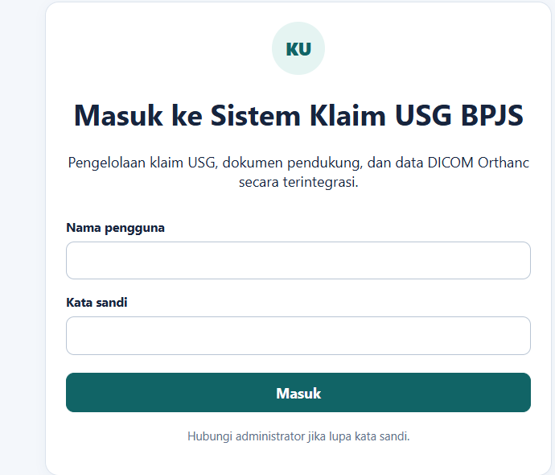
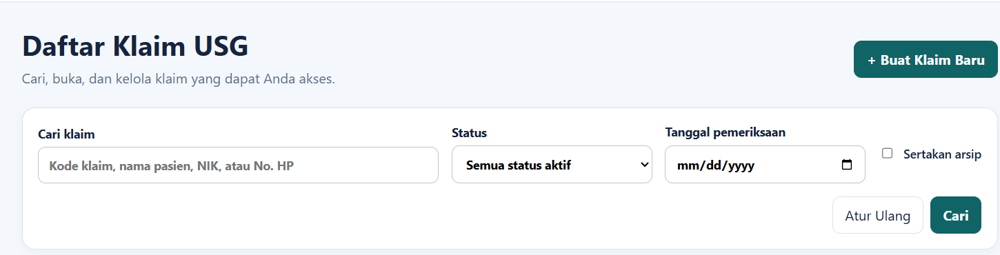
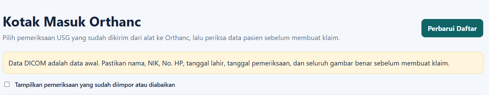
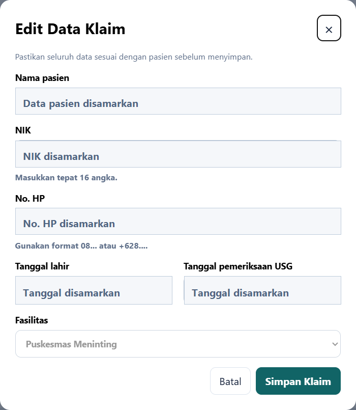
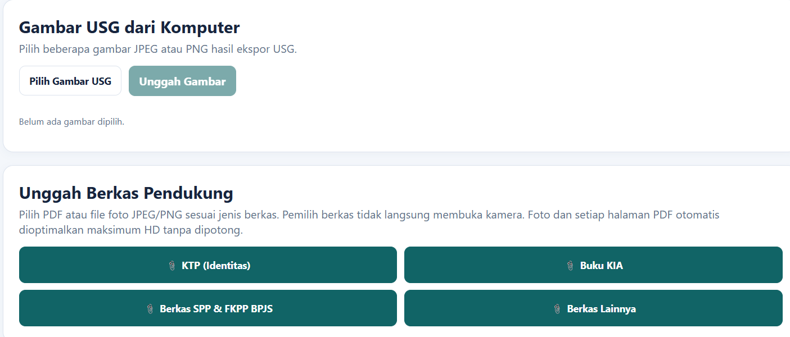
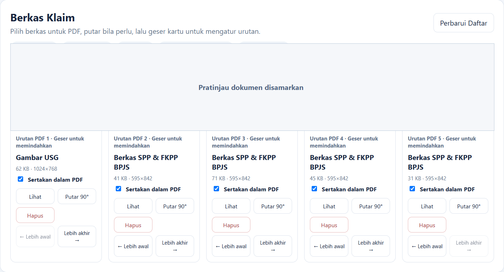
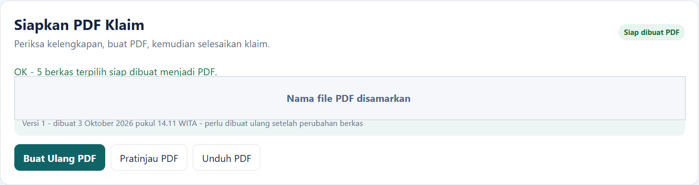

# Panduan Ringkas Petugas Klaim USG BPJS

Gunakan panduan ini untuk membuat klaim, melengkapi berkas, dan menghasilkan PDF klaim. **Selalu pastikan identitas pasien dan semua berkas sudah benar sebelum membuat PDF.**

## Alur cepat

**Masuk → Ambil dari Orthanc atau buat klaim baru → Periksa data pasien → Lengkapi berkas → Atur isi PDF → Buat dan periksa PDF → Selesaikan klaim → Keluar**

## 1. Masuk ke aplikasi

1. Buka alamat aplikasi berakhiran `/exec` yang diberikan administrator.
2. Masukkan **Nama pengguna** dan **Kata sandi**, lalu pilih **Masuk**.
3. Jika diminta, buat kata sandi baru. Jangan membagikan kata sandi kepada orang lain.

*Gambar 1. Isi nama pengguna dan kata sandi, kemudian pilih **Masuk**.*

## 2. Mulai klaim

Pilih salah satu cara berikut.

### A. Dari Orthanc

1. Buka menu **Orthanc**, lalu pilih **Perbarui Daftar**.
2. Pada pemeriksaan berstatus **Siap ditinjau**, pilih **Tinjau**.
3. Cocokkan pasien dan pemeriksaan: **nama, NIK 16 angka, No. HP, Nama Dokter, tanggal lahir, tanggal USG, fasilitas, dan seluruh gambar USG**.
4. Isi No. HP secara manual. Jangan menganggap ID pasien dari alat selalu merupakan NIK yang benar.
5. Pilih hanya gambar milik pasien tersebut, centang konfirmasi, lalu pilih **Buat Klaim dari Orthanc**.

Gunakan **Abaikan Pemeriksaan** hanya untuk data uji, duplikat, atau pemeriksaan yang memang tidak digunakan.

### B. Klaim baru secara manual

1. Buka menu **Klaim**, lalu pilih **+ Buat Klaim Baru**.
2. Isi nama pasien, NIK 16 angka, No. HP (`08...` atau `+628...`), Nama Dokter, tanggal lahir, tanggal pemeriksaan USG, dan fasilitas.
3. Periksa kembali, lalu pilih **Simpan Klaim**.
4. Jika klaim masih berstatus **Draf**, pilih **Mulai Pengumpulan Berkas**.

*Gambar 2. Gunakan **+ Buat Klaim Baru** atau kotak pencarian pada halaman Klaim.*

*Gambar 3. Pilih **Perbarui Daftar**, lalu tinjau pemeriksaan yang siap. Data DICOM tetap harus diverifikasi.*

*Gambar 4. Periksa seluruh data pasien sebelum memilih **Simpan Klaim**. Data contoh pada gambar telah disamarkan.*

## 3. Lengkapi berkas

- Jika gambar belum berasal dari Orthanc, gunakan **Pilih Gambar USG** → pilih JPEG/PNG → **Unggah Gambar**.
- Unggah dokumen melalui tombol yang sesuai: **KTP (Identitas)**, **Buku KIA**, **Berkas SPP & FKPP BPJS**, atau **Berkas Lainnya**.
- Pilih satu PDF atau foto JPEG/PNG, lalu tunggu pesan berhasil sebelum memilih berkas berikutnya.
- Jika berkas diunggah dari perangkat lain, pilih **Perbarui Daftar** agar berkas terbaru tampil.

*Gambar 5. Pilih tombol unggah sesuai jenis berkas.*

## 4. Periksa dan atur isi PDF

1. Pilih **Lihat** untuk memastikan isi berkas jelas dan milik pasien yang benar.
2. Gunakan **Putar 90°** bila orientasi belum benar.
3. Centang **Sertakan dalam PDF** hanya pada berkas yang akan dikirim.
4. Atur urutan dengan menggeser kartu atau memakai **Lebih awal / Lebih akhir**.
5. Pastikan sedikitnya satu **Gambar USG** dipilih. Ikuti pesan pada bagian **Siapkan PDF Klaim** bila masih ada yang perlu diperbaiki.

*Gambar 6. Gunakan **Lihat**, **Putar 90°**, **Sertakan dalam PDF**, serta **Lebih awal / Lebih akhir**. Pratinjau dokumen pada gambar telah disamarkan.*

## 5. Buat dan selesaikan PDF

1. Pilih **Buat PDF** atau **Buat Ulang PDF**.
2. Periksa lagi pasien, NIK, No. HP, Nama Dokter, tanggal USG, dan jumlah berkas.
3. Centang konfirmasi bahwa seluruh berkas berasal dari pasien yang sama, lalu pilih **Ya, Buat PDF**.
4. Pilih **Pratinjau PDF** dan periksa setiap halaman: identitas, isi, arah gambar, urutan, dan keterbacaan.
5. Jika sudah benar, pilih **Unduh PDF**, lalu **Selesaikan Klaim**.

**Perhatian:** setelah klaim diselesaikan, unggahan dan perubahan berkas dikunci. Jika menemukan kesalahan setelah PDF dibuat, jangan gunakan PDF tersebut; hubungi administrator.

*Gambar 7. Pastikan status **Siap dibuat PDF**, kemudian buat, pratinjau, dan unduh PDF. Nama file pada gambar telah disamarkan.*

## Status yang perlu diketahui

| Status | Arti / tindakan petugas |
|---|---|
| **Draf** | Periksa data, lalu mulai pengumpulan berkas. |
| **Mengumpulkan berkas** | Data masih dapat diperbaiki dan berkas dapat dilengkapi. |
| **PDF dibuat** | Pratinjau dan unduh PDF, lalu selesaikan klaim jika benar. |
| **Selesai** | Klaim terkunci dan pekerjaan selesai. |
| **Diarsipkan** | Klaim disimpan sebagai arsip; hubungi administrator bila perlu dibuka. |

## Jika ada kendala

- **Klaim tidak ditemukan:** cari dengan kode klaim, nama pasien, NIK, No. HP, Nama Dokter, status, atau tanggal USG; lalu pilih **Cari**.
- **Pemeriksaan Orthanc belum terlihat:** pilih **Perbarui Daftar**. Jika tetap tidak muncul atau berstatus **Gagal diterima**, hubungi administrator.
- **Unggahan terasa berhenti:** jangan langsung mengunggah berulang kali. Tunggu, pilih **Perbarui Daftar**, dan periksa apakah berkas sudah tersimpan.
- **Data pasien/berkas salah:** hentikan proses dan perbaiki sebelum membuat PDF. Jika sudah terkunci, hubungi administrator.

## Keamanan data pasien

- Gunakan hanya klaim dan fasilitas yang menjadi kewenangan Anda.
- Jangan membagikan kata sandi, tautan aplikasi, tangkapan layar data pasien, atau PDF klaim melalui saluran yang tidak disetujui.
- Jangan meninggalkan halaman pasien terbuka pada perangkat bersama.
- Setelah selesai bekerja, pilih **Keluar**.

**Bantuan administrator:** ____________________
**Nomor kontak:** ____________________
